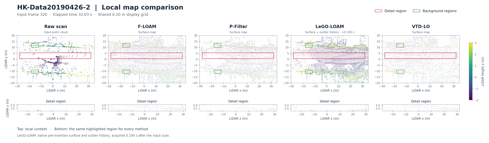
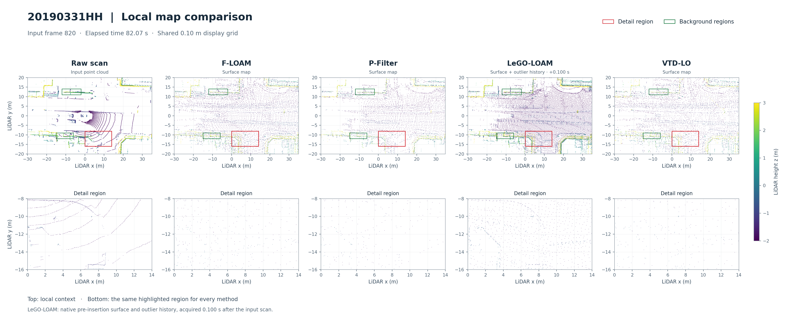
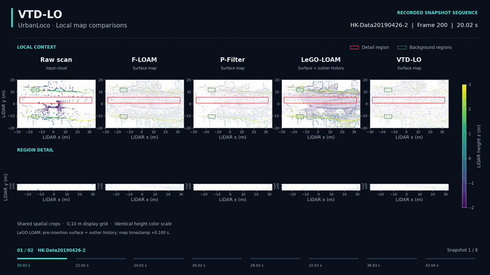

# VTD-LO

### Voxel-Temporal Dynamic Filtering LiDAR Odometry

VTD-LO estimates sensor motion from 3D LiDAR scans while maintaining a local feature map. Its voxel-temporal statistics identify geometrically unstable regions, and its adaptive residual weighting combines temporal stability, map-point age, and measurement range during scan-to-map registration. The LiDAR-only pipeline couples geometric feature matching with temporal map statistics.

[Evaluation](#evaluation) · [Map comparisons](#map-comparisons) · [Demos](#demos) · [Method](docs/method.md) · [Build and run](docs/usage.md) · [ROS interfaces](docs/usage.md#ros-interfaces)

## Evaluation

| Study | Experimental coverage |
| --- | --- |
| Benchmark evaluation | KITTI odometry sequences 00–10, M2DGR ground-robot recordings, and five UrbanLoco vehicle recordings |
| Parameter sensitivity | 36 full-sequence sensitivity runs covering voxel resolution, dispersion thresholds, observation counts, residual weights, and joint settings |
| Residual-weight fusion | Seven weighting choices evaluated on KITTI 01, 05, and 08 |
| Moving-to-static behavior | A controlled synthetic 180-scan move–stop–restart scene evaluated with four module configurations |
| Congested traffic | Nine controlled synthetic traffic conditions with three noise seeds per condition |
| Motion initialization | 26 translation and rotation perturbation tests on KITTI 04 and 07 |
| Native-map comparison | Eight method–recording runs and 64 native-map snapshots across two UrbanLoco recordings |

## Map comparisons

### HK-Data20190426-2



### 20190331HH



The source scan and four methods share spatial crops, a 0.10 m display grid, and height colors. Red boxes identify the detail region; green boxes identify background regions. The second row presents the same detail region for every method. LeGO-LOAM displays its native pre-insertion surface and outlier history at the indicated acquisition offset.

## Demos

### Native-map comparison over time · UrbanLoco

<p align="center">
  
</p>

Eight saved instants from each recording show the source scan alongside F-LOAM, P-Filter, LeGO-LOAM, and VTD-LO. The snapshot sequence preserves the shared view and display settings, with frame indices and elapsed times identifying each observation.

### Temporal local-map replay · KITTI 08

<p align="center">
  
</p>

Three recorded time windows show the local feature maps used for registration, with the estimated pose and position along the route. Playback is at 1× recorded time; cyan denotes edge features and amber denotes surface features.

### Local-map geometry · KITTI 08

<p align="center">
  
</p>

Eight-second viewpoint orbits present the geometry of three local-map snapshots, with a 10 m scale and a route locator.

### Five recorded runs · UrbanLoco

<p align="center">
  
</p>

Five UrbanLoco runs use one shared sensor configuration. Their saved pose estimates are replayed sequentially at 40×, with the current position, elapsed time, and sequence progress.

### Complete trajectory replay · KITTI 02 and 08

<p align="center">
  
</p>

The saved trajectories for KITTI 02 and 08 are replayed together at 20× recorded time.

[Recording details and sequence information](docs/demonstrations.md)

## Method

VTD-LO couples feature-to-map registration with a temporal model of local geometry. Edge and planar features form the registration map; repeated observations update separate voxel statistics for the two feature types.

| Component | Role in VTD-LO |
| --- | --- |
| **Voxel-temporal statistics** | Track geometric variation through online observation counts, means, and variances. |
| **Two-stage dynamic suppression** | Screen unstable correspondences during registration and remove unstable geometry during local-map updates. |
| **Adaptive residual weighting** | Combine voxel stability, map-point age, and measurement range into bounded weights for robust pose optimization. |

The temporal model follows the spatial consistency of repeated observations. Stable surfaces on stationary vehicles can contribute geometric constraints, while voxel statistics guide the treatment of changing regions throughout registration and map maintenance.

[Method and parameter reference](docs/method.md) · [ROS interfaces](docs/usage.md#ros-interfaces)

## Get started

The reference environment is **Ubuntu 20.04 with ROS Noetic**. The package uses **C++17, PCL, Eigen, and Ceres**.

Follow [Build and run](docs/usage.md) to install dependencies and create a catkin workspace. With the workspace sourced and `08.bag` placed in `~/DATASET/KITTI/`:

```bash
mkdir -p "$HOME/vtd_results"
roslaunch vtd_lo kitti.launch \
  seq:=08 \
  tum_path:="$HOME/vtd_results/kitti08.txt"
```

The launch file starts bag playback, odometry, mapping, and visualization. For M2DGR, provide a bag path:

```bash
roslaunch vtd_lo m2dgr.launch \
  bag_file:="/absolute/path/hall_01.bag" \
  tum_path:="$HOME/vtd_results/hall01.txt"
```

## Acknowledgements

VTD-LO builds on the LiDAR odometry work and open-source implementations of [LOAM](https://github.com/laboshinl/loam_velodyne), [A-LOAM](https://github.com/HKUST-Aerial-Robotics/A-LOAM), [F-LOAM](https://github.com/wh200720041/floam), and [PFilter](https://github.com/yjsx/PFilter). We thank their authors and contributors. VTD-LO develops voxel-temporal dynamic suppression and adaptive residual weighting within this feature-based odometry framework.

We also thank the teams behind [KITTI](https://www.cvlibs.net/datasets/kitti/eval_odometry.php), [UrbanLoco](https://github.com/weisongwen/UrbanLoco), and [M2DGR](https://github.com/SJTU-ViSYS/M2DGR) for making their datasets available. The demonstrations above use KITTI and UrbanLoco recordings.
