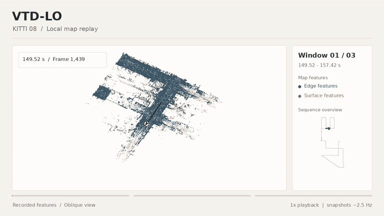
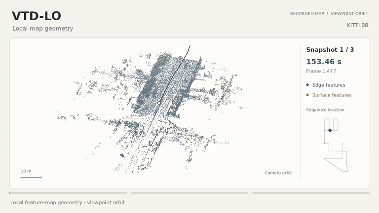
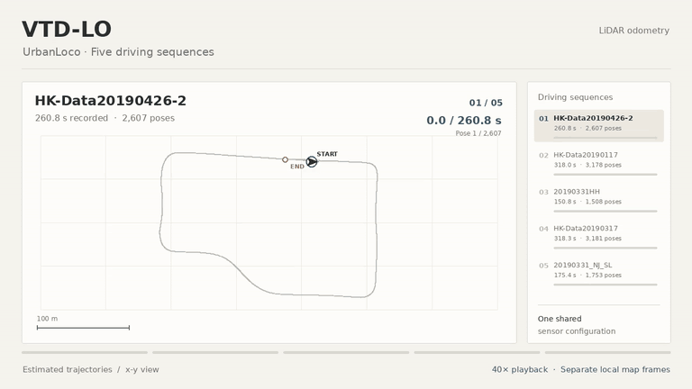

# VTD-LO

**Voxel-Temporal Dynamic Filtering LiDAR Odometry**

LiDAR odometry with voxel-temporal dynamic suppression and adaptive residual weighting.

[Method](docs/method.md) · [Build and run](docs/usage.md) · [Video gallery](https://qfwang23.github.io/VTD-LO/)

## Local-map replay

KITTI 08 · Three recorded windows · 1× playback. Slate blue: edge features; sienna: surface features.

## Map geometry

KITTI 08 · Three local-map snapshots, each shown through an eight-second viewpoint orbit.

## Urban trajectories

UrbanLoco · Five recorded runs · One shared sensor configuration · 40× playback.

---

[Recording details](docs/demonstrations.md) · [Acknowledgements](docs/acknowledgements.md)
